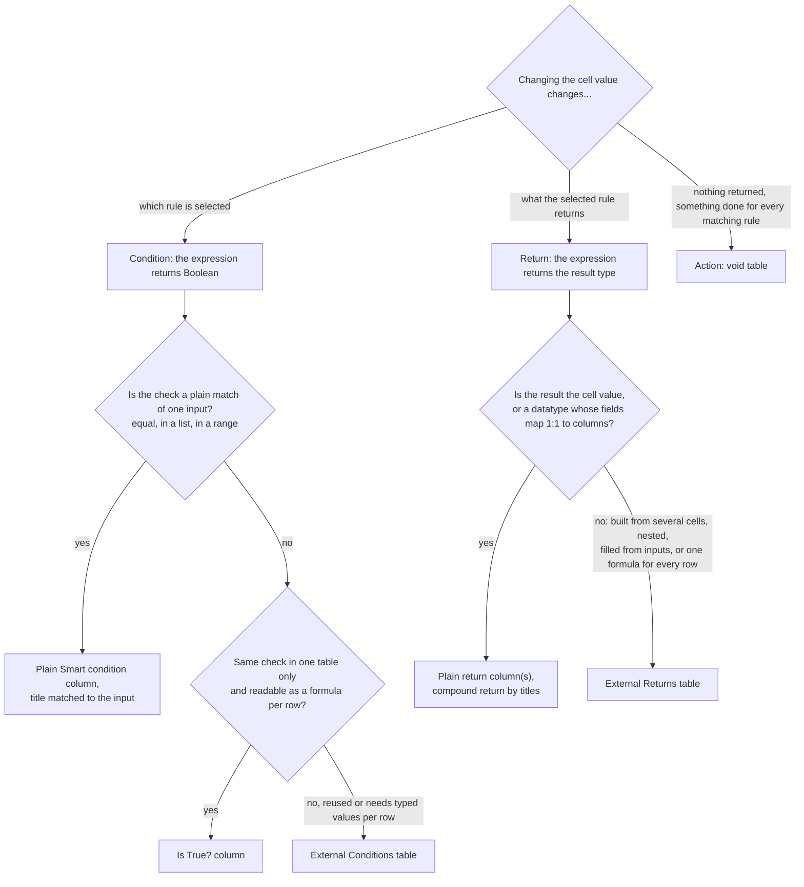

# External tables and Rules tables: declaring conditions, returns and actions

The decision-table skill's reference for every table where a column's logic is declared by hand: the external **Conditions**, **Returns** and **Actions** tables that Smart tables use through their column titles, and the **Rules** table with its column codes. Read it before writing or changing one, and when you must decide whether a column is a condition or a return. Section names in parentheses (Non-negotiables, Workflow, Writing the table, Verification checklist) are in short form in [SKILL.md](../SKILL.md) and in full in [non-negotiables.md](non-negotiables.md) and [workflow-and-writing.md](workflow-and-writing.md); any other is in a file listed under **Where to read** there.

Sources:
- The syntax comes from the Reference Guide chapters bundled with the OpenL Studio connection: *Decision Table Structure*, *Rules Tables*, *External Tables Usage in Smart Decision Tables*, *Local Parameters in Decision Table*, *Smart Rules Table*, *Result of Custom Data Type*, *Collecting Results* and *Using References to Expressions*. Re-read the chapter when the Studio version changes.
- The patterns below were checked in OpenL projects; the ones not marked **compile-check** compile.
- Anything marked **compile-check** was seen but not verified as compiling. Compile it on the branch before relying on it.

## 1. The one idea behind both

Every hand-declared column has the same parts. In a Rules table they sit in the table's own header rows; in an external table they sit in a separate table that the Smart table reaches through its column title.

| Part | What it holds | Rules table | External table |
|---|---|---|---|
| **Kind** | condition, horizontal condition, return, action | the code row: `C1`, `HC1`, `RET1`, `CRET`, `A1`, `MC1` | the table keyword: `Conditions`, `Returns`, `Actions` |
| **Inputs** | the table inputs the expression reads | not needed: the signature is in scope | the `Inputs` row |
| **Expression** | what the column does with its cell values | the expression row | the `Expression` row |
| **Parameter** | the type and name of each value a rule's cell holds | the parameter row | the `Parameter` row |
| **Title** | the column title | the title row (free text, not used by the engine) | the `Title` row: the exact text the Smart table's column must carry |

The cell under a column, in each rule row, is the value of its parameter for that rule. The expression combines that value with the inputs.

## 2. Condition or return: how to tell

Ask one question of a column: **if this cell's value changes, does it change which rule is selected, or what the selected rule gives back?**



How OpenL itself decides, so you can read an existing table:

- **Rules table:** by the code row only. `C`, `MC` and `HC` columns are conditions, `RET` and `CRET` are returns, and `A` columns are actions. Any other cell in the code row is a comment column.
- **Smart table:** by its column titles. A title equal to the `Title` of an external element binds to that element and takes its kind: Conditions makes a condition, Returns a return, Actions an action. External element titles are checked **before** inputs ("names of external tables have higher priority over input parameters"). Every other title is matched to an input, or to a field of an object input, which makes a condition. The **last** columns are the return: one return column, up to three as a fallback chain, or the columns of a compound return matched to the fields of the return datatype. A title containing `true` (or `Is True?`) is a Boolean expression condition.
- **To confirm** a reading in Studio, hover over each title. A title bound to an external table shows a link to it; a title matched to an input shows which one. An *Ambiguous matching* warning means a title must be made more specific.

**When a cell's value only needs to be carried into the result, it is a return parameter, never a condition.** Some projects declare such values as Conditions with the expression `true`, which filters nothing and only declares a parameter. Do not copy this in new tables: put the value in the Returns element that uses it. A condition column that matches everything confuses the reader and the gap check.

## 3. When to create an external table

Create one only when a plain Smart column cannot express the column. Check the cheaper options first, in this order:

1. **Plain Smart condition.** The check is equality, "is in this list" or "is in this range" on one input or one field of an input. A title matched to the input does it, so no external table is needed.
2. **`Is True?` column.** The check is a Boolean formula that differs from row to row, or is needed in one table only.
3. **Plain or compound return.** The result is the cell value, or a datatype whose fields map one-to-one to return columns matched by title (two title rows for a nested object, as the *Result of Custom Data Type* chapter shows).
4. **External Conditions table.** Create one when the same non-plain check, typed by the values in each row, is used in several tables. Examples: an empty list in the request means "any product"; two inputs are compared with each other; a list in the request must overlap a list in the row. Also when the check needs typed values per row that an `Is True?` formula would make unreadable.
5. **External Returns table.** Create one when the result is built from several cell values in a way titles cannot express: a constructor call, nested objects, arrays assembled from cells, fields filled from inputs, `removeNulls`, the text of a cell's expression. Also when one formula applies the cell values the same way in every row (`baseRate * factor`), and when the same construction is used by several tables.
6. **External Actions table.** Create one only for a `void` table, or when something must be done for every matching rule. Rating tables return values and do not use actions; ask before adding one.
7. **Rules table.** Use one only when the task or the sibling tables ask for it, or when the logic needs what only a Rules table has. Examples: column codes in a fixed order, an `MC1` column for a list of values returned per rule, actions mixed with returns.

Always check first whether the project already has an external element that does the job (`list tables` filtered by the Conditions, Returns and Actions kinds). Reuse it with its exact title rather than declaring a second one.

## 4. External tables in detail

### 4.1 Grid

```
| Conditions <Name>                                                            |  (header, merged across all columns)
| Inputs     | <Type> <name>, <Type> <name>   (merged across the elements that share it) |
| Expression | <expression of element 1>  | <expression of element 2 (merged over its 2 parameters)> |
| Parameter  | <Type> <name>              | <Type> <name>   | <Type> <name>   |
| Title      | <Title 1>                  | <Title 2a>      | <Title 2b>      |
```

- **Header:** the keyword `Conditions`, `Returns` or `Actions`, then a name. The guide makes the name optional; always give one, unique in the project, so the table can be found and listed.
- **Keyword column:** `Inputs`, `Expression`, `Parameter`, `Title` down the first column. The guide lets you omit it when the rows are in this default order. Keep it anyway: it documents the table and every project read keeps it.
- **One column per parameter.** An element (one condition, one return, one action) covers one or more adjacent columns. Its `Expression` cell is merged across all its parameter columns.
- **One table, several elements.** A Conditions table can hold many conditions side by side, each with its own Inputs, Expression, Parameter and Title (for example, one table holding five independent list conditions).
- **Where it lives.** It must be visible to the Smart table that uses it: the same module or a module it depends on. Projects often keep external tables in the Model module, next to the datatypes they read. Follow the project; with no precedent, put them in the module of the first table that uses them, and ask before creating a new place.

### 4.2 Inputs: what to list

- **List every table input the expression reads,** as `Type name`, comma-separated in one cell: `PromotionRequest promotionRequest`; `String[] entities, ProductDimensions dimensions, Boolean scoped`.
- **They are matched to the Smart table's signature by type and name**, not by exact name (guide). Use the signature's parameter names anyway: the match is then unambiguous, and the external table reads like the table that uses it.
- **Fields of an object input are read bare** when only that input owns them. With the input `PromotionRequest promotionRequest`, the expression reads `products`, `promotionCode` and `channel` directly. The skill's rule applies here too: keep the owner prefix only when two inputs have a field of that name.
- **Merge the Inputs cell** across the elements that read the same inputs. Give separate cells to elements that read different ones.
- **Optional for Returns and Actions** (guide). A Returns element built only from its own parameters has an empty Inputs cell. A Conditions element always needs the input it checks.
- **Nothing extra.** An input listed but not read is noise, and it narrows which Smart tables can use the element. List only what the expression reads.

### 4.3 Expression: what to write

- **Conditions:** an expression that returns `Boolean`, reading the inputs and the element's own parameters. The guide allows several statements, the last one returning `Boolean`. Keep it to one readable expression, and call a helper rule for anything longer.
  - Examples: `contains (productList, products) or isEmpty(products)` (a request list overlapping the row's list, empty meaning any); `channel == resChannel or isEmpty(channel)`.
  - **Short form** (*Local Parameters* chapter): when the check is a plain match, write only the input's name as the expression and only the type as the parameter. Use a scalar type for equality, an array type (`CoverageOptionName[]`) for "is in the list", a range type for "is in the range". OpenL then generates the check, so never hand-write `==` or `contains` for it.
  - When a condition is that plain, a plain Smart column is usually enough (section 3). Use the short form when the element must still be shared under one title.
- **Returns:** an expression whose type is the Smart table's return type, or the element type for a `Collect` table. It reads the inputs, its own parameters, and the parameters of the other external elements of the same Smart table: a return expression reads the parameters of the conditions declared beside it (guide: "any parameters of condition columns in the return column"; compiling).
  - Typical bodies: a datatype constructor with named fields (`PromotionParameters (promotionCode = resPromotionCode, channel = resChannel, products = promotionRequest.products, …)`); a call to another rule; a formula (`baseRate * factor`).
  - `$Expr.<parameter>.textValue` gives the text of the expression a cell holds, when the result must carry the formula as well as its value (*Using References to Expressions*).
- **Actions:** statements run for every matching rule. Assignments and rule calls only; the table returns `void`.
- **Values come from cells, logic from the expression.** No number of the requirement is hard-coded in an expression. A factor, a limit or a list belongs in the cells, so it can be read and changed rule by rule.

### 4.4 Parameter: what to declare

- **One `Type name` per column:** `Product[] productList`, `Boolean resStackable`, `Double minValue_`. The name is one word.
- **One parameter per value a rule's cell holds.** A condition that needs a minimum and a maximum has two parameters, two columns and two titles, with its expression merged over both. An element that builds an object from ten values has ten.
- **The type is the type of the value in the cell.** Use the vocabulary type for a vocabulary value, never `String`, so a misspelled value fails to compile. Use an array (`State[]`) for a list in one cell, `IntRange` / `DoubleRange` for a band, and `Boolean` for a flag.
- **Names are unique across all the elements one Smart table uses,** because a return expression can read a condition's parameter. Projects use a prefix or a suffix to keep them apart (`res…`, `…_`). Name a parameter after what it holds; keep it different from the input it is compared with (`productList` against the input `products`).
- **No name, type only:** only in the short form (section 4.3), where OpenL creates the parameter (`P1`) itself.

### 4.5 Title: what the Smart table must carry

- **The Smart table's column title must equal the element's title** (guide: "must exactly match"). A line break in the Smart table's title cell matched a space in the external title (compiling: `Promotion Code\n[Promotion]` matched `Promotion Code [Promotion]`). Any other difference breaks the binding, and the column is then matched to an input instead, or fails.
- **Make external titles unique** across every external table the Smart table can see. External titles are checked before inputs, so a generic title (`Product List`) in one external table captures a plain column of the same name in any table that can see it. Add the context in brackets: `Product List [Promotion]`, `Sales Channel [Promotion]`.
- **A business name, with the unit where there is one.** Use the requirement's term, the same rule as for any column title ([naming-and-layout.md](naming-and-layout.md), Naming and layout).
- **Title layouts and the Smart table's matching layout.** The Smart table copies the external title layout exactly:

| External Title row | Smart table columns |
|---|---|
| One title per parameter column | one titled column per parameter |
| One title merged over all the element's parameter columns (**compile-check**) | one title cell merged over the same number of columns |
| Two title rows, a group title merged over its sub-titles, for a nested object (compiling: `Promotion Rules` over four flags) | two title rows, the same merges; the titles of the other columns merged down over both rows |

### 4.6 Using the elements in the Smart table

- **Column order:** conditions first (plain and external, plain conditions before expression conditions, for speed), then the return columns. An external element's columns stay adjacent and in the external table's parameter order.
- **Cells hold parameter values,** typed as declared: a vocabulary value, a list of values (`[Email, Letter]`), a range, a Boolean or a number. A cell may hold an expression (`= …`) when the parameter type allows it; `$Expr` then reads its text.
- **Every Smart feature still applies:** a blank condition cell matches any value, the first match wins, and the catch-all row goes last. `Collect` returns all matches (`SmartRules Collect PromotionParameters[]`). The skill's Non-negotiables apply to the rows as to any decision table.
- **Lookups:** a Smart lookup can use external elements too. A return element with several parameters then takes as many columns under each horizontal value, with the horizontal values merged over them (**compile-check**). Draw the layout and compile it before filling values.

### 4.7 A complete example (compiling; names and values are illustrative)

External conditions, in the Model module:

| Conditions PromotionConfigurationConditions | | | | |
|---|---|---|---|---|
| Inputs | PromotionRequest promotionRequest *(merged across)* | | | |
| Expression | contains (productList, products) or isEmpty(products) | contains (statesList, states) or isEmpty(states) | promotionCode == resPromotionCode or isEmpty(promotionCode) | channel == resChannel or isEmpty(channel) |
| Parameter | Product[] productList | State[] statesList | String resPromotionCode | SalesChannel resChannel |
| Title | Product List [Promotion] | States List [Promotion] | Promotion Code [Promotion] | Sales Channel [Promotion] |

External return (the Expression is merged over its parameter columns; abridged):

| Returns PromotionConfigurationReturn | | | |
|---|---|---|---|
| Inputs | PromotionRequest promotionRequest | | |
| Expression | PromotionParameters (promotionCode = resPromotionCode, channel = resChannel, products = promotionRequest.products, promotionType = resPromotionType, stackable = resStackable, …) | | |
| Parameter | PromotionType resPromotionType | Boolean resStackable | … |
| Title | Promotion Type | Stackable | … |

The Smart table that uses them (abridged):

| SmartRules Collect PromotionParameters[] PromotionParameters (PromotionRequest promotionRequest) | | | | | |
|---|---|---|---|---|---|
| Promotion Code [Promotion] | Sales Channel [Promotion] | Product List [Promotion] | States List [Promotion] | Promotion Type | Stackable |
| SPRING10 | Broker | | | Default | FALSE |
| WELCOME5 | Broker | | | Default | TRUE |

The four bracketed titles bind to the conditions, and `Promotion Type` and `Stackable` to the return. A blank `Product List` matches any request, because of the `or isEmpty(products)` in the expression and because a blank cell matches anything. The return builds one `PromotionParameters` per matching row, reading the condition parameter `resPromotionCode`.

## 5. Rules tables in detail

### 5.1 Grid

```
| Rules <ReturnType> <Name> (<Type> <param>, …)                        |  header, merged across the table
| C1            | C2              | HC1 (lookup only) | RET1            |  code row
| <expression>  | <expression>    | <expression>      | <expression>    |  expression row
| <Type> <name> | <Type> <name>   | <Type> <name>     | <Type> <name>   |  parameter row
| <Title>       | <Title>         | (horizontal values) | <Title>       |  title row(s)
| rule values ...                                                       |  one row per rule
```

### 5.2 Column codes (code row)

- **`C1`, `C2` …:** vertical conditions. The rule fires when all its conditions are true.
- **`MC1`:** the first column with merged rows. It fixes the height of each rule, for a rule that returns a list written over several rows.
- **`HC1`, `HC2` …:** horizontal conditions (lookups only). Each has one parameter and no title cell. The first `HC` or `RET` column comes after every vertical condition and comment column, and no comment column may sit among the horizontal conditions. The title cell of each vertical condition is merged down over all the horizontal header rows, and must not be merged into the horizontal part (Studio reports it as an error).
- **`RET1` …:** returns. The first fired, non-empty value is returned. With several `RET` columns, the first non-empty one wins, so they are a fallback chain, never several results.
- **`CRET`:** a collecting return. All matching rules' values are returned, and the return type is an array.
- **`A1` …:** actions, run for every rule whose conditions are all true. With a return column, processing stops at the first rule that fires with a non-empty result.
- **Any other text** in the code row makes that column a comment column, ignored by the engine.

### 5.3 Expression row

- **Conditions:** a `Boolean` expression that reads the signature's inputs and the column's parameters. Use the **short form** whenever the check is a plain match. Write the input's name as the expression and only the type as the parameter: a scalar type gives equality, an array type gives "is in the list", a range type gives "is in the range". OpenL generates the check ([conditions-and-completeness.md](conditions-and-completeness.md), Conditions and columns; Example 5 in the worked examples).
- **Returns:** an expression of the return type. When the return is simply the cell value, leave both the expression and the parameter empty.
- **Actions:** statements.

### 5.4 Parameter row

- **One `Type name` per column.** A condition, return or action with several parameters merges its code cell and its expression cell across all its parameter columns (*Rules Tables* chapter). Use this when the condition is not a plain AND of single-parameter conditions.
- **The parameter name is the name the expression uses for the cell value.** It is unique in the table. A return expression may read condition parameters by these names, and condition cells may hold formulas that read inputs.

### 5.5 Title row

Free text, not used by the engine: the business name of the column, with the unit, as in any decision table. In a lookup, the title row also holds the horizontal values, after the vertical titles.

## 6. Writing one, step by step

1. **Decide the kind of each column** with the test in section 2, and the construct with section 3. Write the decision down in the reply: which columns are conditions, which are returns, and why an external table or a Rules table is needed.
2. **Search the project** for an existing external element that does the same job, and reuse it with its exact title.
3. **Read the model:** the `Datatype` and vocabulary tables for every input, field and parameter type, and the return datatype's fields.
4. **Write the external table** (or the Rules table's header rows): Inputs (only what the expression reads, named as in the signature), Expression, Parameter (typed, uniquely named), Title (unique, business name). Merge Inputs and Expression where elements share them.
5. **Write the Smart table** with titles that copy the external titles exactly, in the same layout and order, then the rule rows.
6. **Compile and check every binding.** No errors. Each title bound to the intended element or input (hover over it in Studio). No *Ambiguous matching* warning.
7. **Run a rule per element:** one row per condition element with a matching input and with a non-matching one, empty included when the element treats empty as "any". Check the return object field by field. Hand the cases to testing as unit tests, as for any new table.
8. **Run the convention check** ([workflow-and-writing.md](workflow-and-writing.md#convention-check), Convention check) on the Smart table and the external table together.

## 7. Anti-patterns

- ❌ An external Conditions table for a plain equality, list or range match on one input. A plain Smart column does it.
- ❌ A condition with the expression `true`, declared only to carry a value into the result. The value belongs in the Returns element.
- ❌ A generic external title (`Product`, `State`, `Plan`). It captures plain columns of the same name in every table that can see it. Add the context in brackets.
- ❌ Inputs listed that the expression does not read, or input names that differ from the signature's.
- ❌ A vocabulary value declared as a `String` parameter, or compared to a string literal inside the expression.
- ❌ A number of the requirement written inside the Expression instead of in the cells.
- ❌ A Smart table title that differs from the external title, or columns of one element split, reordered or missing.
- ❌ A Rules table where a Smart table with an `Is True?` column or an external element would do. Hand-written `==` or `contains` where the short form does it.
- ❌ Several `RET` columns used as several results. They are a fallback chain; use a compound return or an external Returns element.
